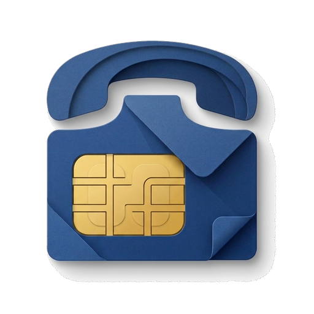
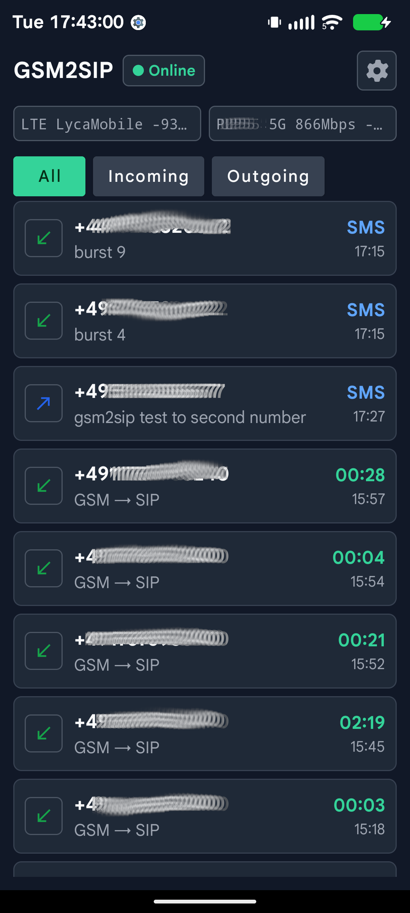
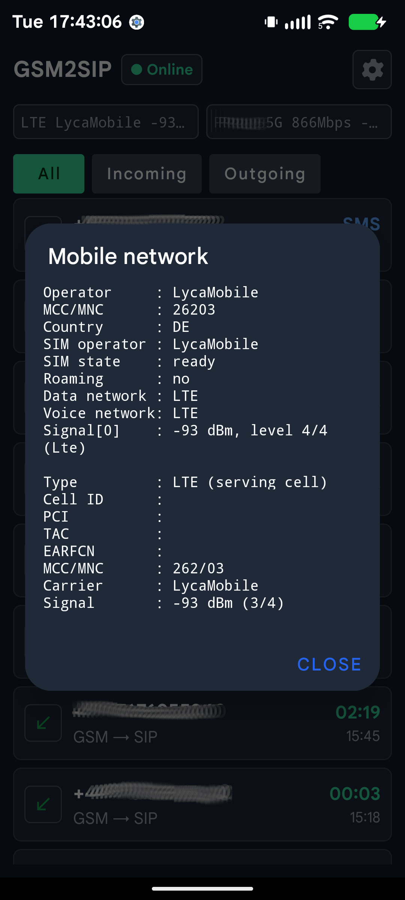
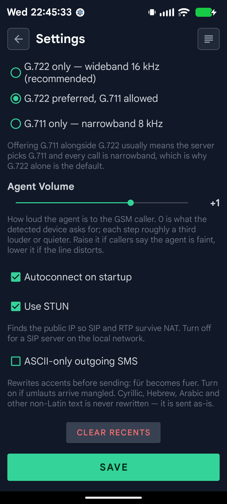

<p align="center">
  
</p>

<h1 align="center">gsm2sip</h1>

<p align="center">
Bridges Android phone to any SIP server as GSM Gateway
</p>

| Calls and messages | Link detail | Settings |
|--------|-----------------|----------|
|  |  |  |

## How It Works

A dedicated rooted Android phone with a local SIM card acts as a SIP-to-GSM gateway:

- **Inbound**: Someone calls the SIM's number → the phone answers → the call is bridged to the SIP server, which routes it wherever the dialplan says (an AI agent, a queue, an extension)
- **Outbound**: the SIP server sends an INVITE with an `X-GSM-Forward: +<number>` header → the phone dials that number over GSM → audio is bridged back to SIP
- **SMS**: messages arriving on any SIM are forwarded to the server as SIP MESSAGE, and the server can ask the gateway to send one and be told what became of it — see [SMS over SIP](#sms-over-sip)

Audio flows through shared speaker/mic — both GSM and SIP audio run concurrently on the same hardware, enabled by a Magisk module that disables Android's audio concurrency restrictions.

## Audio Codec

Selectable in Settings, defaulting to **G.722 only** (wideband, 16 kHz):

| Setting | Offered in SDP |
|---|---|
| G.722 only *(default)* | `9` |
| G.722 preferred, G.711 allowed | `9 8 0` |
| G.711 only | `8 0` |

The default is G.722 alone because offering G.711 alongside it means servers
routinely pick G.711 and every call ends up narrowband regardless of what both
ends support.  Whatever is configured, the app still answers with a codec the
remote actually offered rather than failing a call over a preference.

## Supported Devices

| Device | SoC | Agent → caller | Caller → agent | Status |
|---|---|---|---|---|
| Xiaomi Poco X3 NFC (`surya`) | Qualcomm SM6150/SM7150, WCD9375 | digital, via `incall_music` → `Telephony Tx` | digital, via `VOICE_DOWNLINK` | **fully working** on LineageOS and MIUI 14 |
| Samsung Galaxy S4 Mini (`serranolte`) | Qualcomm MSM8960, WCD9304 | digital, via `incall_music` | digital, via `VOC_REC_*` | **fully working** |
| Google Pixel 4a (`sunfish`) | Qualcomm SM7150 | — | — | contributed support; not verified here |
| Ulefone Metal (`metal`) | MediaTek MT6753 (MT6735 family) | digital, via the modem's background-sound player | digital, via `VOICE_DOWNLINK` | working on madOS 8.1 (Android 8.1); verified on live calls, see [MediaTek](#mediatek-mt6735mt6753) |
| Samsung Galaxy S10e (`beyond0lte`) | Exynos 9820, CS47L93 | digital, played into the ABOX in place of the mic | digital, tapped off the ABOX downlink | **working** on LineageOS 23.2, with `abox_pos.ko` |

**The Poco X3 NFC is the reference device and works fully**: G.722 wideband in
both directions, entirely through the modem, with the handset's own microphone
and speaker muted for the whole call — on LineageOS and on Xiaomi's own MIUI 14
(Android 12) alike.

The profile is chosen by the **chip, not the phone's name**: the gateway reads
`ro.board.platform`, the SoC model and `/sys/devices/soc0`, so any
SM6150/SM7150 phone gets it whatever its ROM calls it — Mi 9T / Redmi K20,
Mi Note 10, Redmi Note 7 Pro and the rest of that family (only the Poco X3 NFC
is verified on live calls).  MIUI reports the board as the codename (`surya`)
where LineageOS reports the platform, which is why matching by board name alone
was not enough.  Phones on other chips — the Snapdragon 720G (SM7125) in the
Redmi Note 9 Pro / Poco M2 Pro, for one — fall back to the generic profile until
one is tested.

**The Galaxy S4 Mini works fully too**, which is worth dwelling on because it
is a 2013 handset on LineageOS 16 (Android 9) and armeabi-v7a — and because its
own vendor configuration claims it cannot.  Its
`audio_policy_configuration.xml` declares no `incall_music_uplink` mixPort and
no Telephony Tx device, and `mixer_paths.xml` has no incall-music path at all,
yet the kernel exposes `Incall_Music Audio Mixer MultiMedia1/2` and
`MultiMedia1 Mixer VOC_REC_DL/UL` regardless.

### MediaTek (MT6735/MT6753)

The Ulefone Metal has no mixer to drive — its ALSA card exposes about 85 controls and
no routing matrix — but the MediaTek audio HAL does the in-call routing itself
and gives both directions digitally:

- **Agent → caller.** During a call the HAL hands the output streams we tried
  (`USAGE_VOICE_COMMUNICATION`, `STREAM_VOICE_CALL`) to the
  modem's background-sound player (`AudioALSAPlaybackHandlerVoice` →
  `BGSPlayer`).  It opens with its uplink gain at 0, so the earpiece plays the
  agent and the caller hears nothing.  Four HAL parameters, set through
  `AudioManager.setParameters()` once the call is up, fix that and silence the
  handset: `Set_BGS_UL_Mute=0`, `Set_BGS_DL_Mute=1`,
  `Set_SpeechCall_UL_Mute=1`, `Set_SpeechCall_DL_Mute=1`.  The profile restores
  them when the call ends.
- **Caller → agent.** `AudioSource.VOICE_DOWNLINK` at 16 kHz.  Android 8.1
  rejects the call sources through the public `AudioRecord` constructor
  (`Invalid audio source -1`), so the app falls back to the hidden
  `(AudioAttributes, AudioFormat, size, session)` constructor with the source
  forced into the attributes (8.0 shares the framework code but is untested).
- **Answering.** The modem sends its first `RING` about 1.6 s after the call
  appears and refuses `ATA` before that (`+CME ERROR: 604`), so on this profile
  the app re-asks every 250 ms while the call is still ringing.  If your dialplan starts talking the moment it answers, put a
  short `Wait(1)` first.
- **Permissions.** `CAPTURE_AUDIO_OUTPUT` needs the app installed as a
  priv-app, which the Magisk module already does.

Tested on live calls, inbound (GSM → SIP) and outbound (SIP → GSM).  Inbound
audio in both directions was confirmed by the RTP level statistics and by ear;
outbound, agent → caller likewise, caller → agent by ear only (the statistics
logged during that call show capture level 0).  For outbound, `Dial(PJSIP/+<number>@<endpoint>)` is enough: the
gateway reads the number from the Request-URI, no `X-GSM-Forward` needed.
Not yet checked: audio quality under real use — the echo test is dominated by
network jitter.

### Choosing a device

Support is a property of the **vendor image, not the chip**.  Everything the
SM6150 profile relies on — the `incall_music` mixer, the `VOC_REC_*` capture
routing, the `voice_extn` `vsid`/`call_state` interface — is generic Qualcomm
audio, present across the msm8974→sm8xxx HAL family. 

Check a candidate :

```bash
tools/check-device.sh [adb-serial]
```

The audio-policy check needs no root, so a phone can be vetted before rooting
it.  The HAL and mixer checks need Magisk with Superuser access set to
"Apps and ADB".

What has actually been checked so far:

| Device | SoC | Vendor | Result |
|---|---|---|---|
| Poco X3 NFC | SM6150/SM7150 | Xiaomi MIUI 14 and LineageOS | fully working, verified on live calls |
| Galaxy S4 Mini | MSM8960 | LineageOS 16 | fully working, verified on a live call |
| Pixel 4a | SM7150 | Google | recognised by the check, used by a contributor |
| Galaxy S10e | Exynos 9820 | LineageOS 23.2 | working with `abox_pos.ko`, verified on a live call |

Everything the working profile depends on is generic Qualcomm audio, so other
Qualcomm phones are plausible candidates — but the deciding factors live in the
vendor image, which is exactly what the script above inspects.  A new device
still needs a `DeviceProfile` entry: the mixer names are generic, the front-end
the playback track lands on is not, and the `Mixer BEFORE/AFTER` lines logged
around each call show which one it is.  An unrecognised Qualcomm device falls
back to `genericQualcomm()`.

Getting digital capture on a Qualcomm device depends on one thing that is easy
to miss.  The HAL gates in-call recording — and the per-session voice mutes —
on `voice_is_call_state_active()`, and on LineageOS that flag is never set:

```
voice_extn: update_call_states is_call_active:0 in_call:1, mode:2
```

`MODE_IN_CALL` is set and the modem's voice session is running, yet every VSID
stays `CALL_INACTIVE`, so `VOICE_CALL`, `VOICE_DOWNLINK` and the `VOC_REC_*`
mixers all return silence.  The app announces the call itself
(`vsid=<hex>;call_state=2`) before opening `AudioRecord`.

### The Galaxy S10e: past the HAL, through the ABOX

The S10e's audio HAL has no telephony path at all:
`audio_policy_configuration.xml` declares three mixPorts (`deep`, `fast`,
`primary`) and no telephony device, and `audio.primary.universal9820.so` has
no `TELEPHONY_TX`, no `incall_rec` usecases and no `call_state`/`vsid`
handling.  Through Android there is nothing to inject into and nothing to
capture from.

The call itself runs in the ABOX DSP, though, and its routing is all mixer
controls.  The gateway leaves the HAL out and drives the ABOX directly:

- **Agent → caller:** the agent plays into RDMA8, which is routed onto SIFS2,
  and the voice processor's two uplink inputs (`ABOX NSRC0`/`NSRC1`) are
  switched from the codec (`UAIF0`) to SIFS2.  The agent replaces the
  microphone inside the DSP.  SIFS2 has to be 24-bit, the width the voice
  processor's resampler expects from the codec; at 16 it buzzes.
- **Caller → agent:** `ABOX NSRC5` taps SIFS0, where the downlink leaves the
  voice processor, into WDMA6.  The call volume is applied before that
  point, so the profile keeps it at 70%.
- **The phone itself** is silent for the call: both amps muted, the mic
  inputs turned down.  Neither is in the gateway's path.
- **Muting the mic through Android must not happen here**: the HAL mutes the
  whole voice uplink, the agent with it.

Both PCMs run at the call's codec rate (the ABOX converts), streamed by
`tools/tinypcm` as root.  The catch is that the calliope firmware never
reports a position for WDMA5-7, nor for RDMA6 during a call, so on a stock
kernel those PCMs time out after a second.  `tools/abox-pos` is a small
kernel module that reports the positions in the firmware's place; the
Magisk module loads it at boot.  It is built against the LineageOS 4.14
kernel and loads on every build of it: the layout it depends on is checked
at load, and a kernel that does not match is refused (the app then falls
back to the HAL, which on this phone means no call audio).

## Requirements

- **Device**: Qualcomm-based Android phone with Magisk root, on LineageOS or the
  stock ROM (developed against a Poco X3 NFC; verified on LineageOS and MIUI 14),
  or a Galaxy S10e on LineageOS
- **SIM**: SIM card with voice plan
- **Network**: Stable WiFi connection
- **Power**: Always connected to charger
- **Build host**: Linux with JDK 17+

## What's new in 1.4.14

- **Call audio is passed through untouched** on the Galaxy S4 Mini and the
  SM6150/SM7150 phones (Poco X3 NFC): no gain, no noise gate, no fade-in in
  either direction. The call is digital end to end on these phones, so any
  processing only did harm:
  - The S4 Mini played the agent at 14% media volume (−47 dB), because the same
    stream also drove its loudspeaker. The loudspeaker path is now cut during
    calls and the agent goes out at full level.
  - The noise gate chopped the ends of words and split sentences into separate
    turns, so the agent kept saying it did not understand.
  - On the Poco a ×2 boost pushed the agent into the limiter (distortion).
- **The S4 Mini keeps the right capture source.** A frame-rate check no longer
  swaps it mid-call for one that feeds the agent its own voice back.
- **Android 9 fixes:**
  - Incoming calls no longer crash below Android 11.
  - UDP SIP works below Android 10.
  - SMS go out on the right SIM below Android 12.
- **Stays online:**
  - A failed TLS reconnect no longer wedges SIP until restart.
  - With the screen off and Wi-Fi gone, the gateway briefly wakes the screen
    so the phone rescans; the S4 Mini never rescans on its own.
- **Faster start:** STUN only tries servers that answer, 1.5 s each.
- **Diagnostics:** an opt-in raw PCM dump of both call directions. Create the
  file `files/dump_audio` in the app's data directory; each call then writes
  `files/dump/cap.raw` and `play.raw`.

## What's new in 1.4.1

- **The header fits small screens.** The Online/Offline pill is now a globe
  badge in the same style as the shield, key and Call monitor badges — green
  registered, yellow connecting, red offline — so the settings button no longer
  falls off the edge on 540 px-wide phones such as the Galaxy S4 Mini.

## What's new in 1.4.0

- **Stock MIUI works.** The device profile is chosen by the chip (platform,
  SoC model, `soc0`), not by the board name MIUI replaces with the codename —
  on MIUI the Poco used to fall back to the generic profile, playing the agent
  on the loudspeaker and never capturing the caller.
- **Snoop plays both sides.** Listening in now works on MIUI too: the call is
  unmuted on the speaker and the agent is mixed in on the voice-call stream,
  with the microphone muted throughout — see [Snoop and Call monitor](#snoop-and-call-monitor).
- **Call monitor.** A new setting puts every call on Snoop automatically. A red
  phone badge in the header shows it is on and toggles it (grey when off).
- **No clipping on the agent's voice.** Boosted samples are soft-limited above
  75% of full scale instead of being cut flat; on MIUI agent volume 0 is the
  right setting (+2 was ×4 and clipped).
- **SMS filter** next to All / Incoming / Outgoing; the four chips always fit on
  one line, shortening Incoming/Outgoing with "…" on narrow screens.
- Calls and messages from before today show their date and time
  (`12 Oct 12:32:22`) instead of "Earlier".
- The Snoop button reads **Off** while snooping, not "Stop", which read like
  ending the call.
- Removed: the Pixel 4a battery charge-limit setting.
- Cosmetic: a proper settings gear, and no fixed "Today" label over the list.

## What's new in 1.3.0

- **DTMF reaches the GSM call.** Key presses sent as RFC 4733 telephone-events
  or SIP INFO are played into the mobile call, so IVR menus on the far end
  work — see [DTMF](#dtmf).
- **Failures say why.** A wrong, switched-off or unreachable number now comes
  back as its own SIP code instead of a generic `500` — see
  [Call status codes](#call-status-codes).
- **Ringing lasts as long as the server rings.** An inbound call is no longer
  cut off 30 s after the INVITE while the softphone is still ringing.
- **A rejected call stays rejected.** When the softphone declines, the gateway
  no longer re-sends the INVITE; only transient failures are retried.
- **Long calls survive session timers.** In-dialog INFO, re-INVITE, UPDATE and
  OPTIONS are answered with `200 OK`.
- **Withheld callers** arrive as `anonymous` with the display name
  `Withheld`, `Unknown` or `Payphone`, not as a callable "unknown".
- **Dual-SIM outbound**: the SIM is chosen by the call's caller ID — see
  below.
- **G.711 A-law** encoding fixed for quiet samples: GSM→SIP audio on A-law
  calls no longer sounds like a radio at the edge of range.
- RTP header extensions and padding are skipped instead of decoded as audio.
- The Magisk module seeds its root policy on Android 15 too.
- Google Pixel 4a: recognised by `tools/check-device.sh`.

> **Dual-SIM gateways — outbound caller ID.** With two SIMs, an outbound call
> has to carry the number of the SIM it should leave by as its caller ID; one
> that matches neither is refused with `503 No Matching SIM` rather than dialled
> from the wrong number. A single-SIM gateway dials on its SIM whatever the
> caller ID says — see [Making outbound calls](#3-making-outbound-calls-through-the-gateway).

## Download

Prebuilt APK and Magisk module:
**[github.com/pulpoff/gsm2sip/releases](https://github.com/pulpoff/gsm2sip/releases)**

Install the Magisk module — it carries the APK as a privileged system app.
Building from source is only needed to change something; see below.

## Build

```bash
chmod +x build.sh
./build.sh          # debug build
./build.sh release  # release build
```

Outputs:
- `gateway-magisk.zip` — Magisk module containing the APK, permissions, and audio tools (tinymix, tinycap). This is the only file you need to install.

The APK itself is architecture-independent, but `tinymix` is not: the ALSA
control ioctls encode the size of structs containing `long`, so an arm64 build
and an armeabi-v7a build speak different ioctl ABIs and neither works on the
other's kernel.  The module ships both and `install.sh` picks the matching one
at flash time.  Getting this wrong fails quietly rather than loudly — the wrong
binary is still marked executable, so it looks present while every mixer
command dies with `not executable: 64-bit ELF file`.

## Device Setup

Only the Magisk module needs to be installed — it includes the APK and handles all permissions automatically.

1. **Install Magisk module**: Copy `gateway-magisk.zip` to device, install via Magisk Manager → Modules
2. **Reboot** the device — the module installs the APK as a privileged system app and grants all permissions on boot
3. **Set as default phone app**: Settings → Apps → Default apps → Phone app → gsm2sip
4. **Configure SIP**: open Settings in the app (the gear, top right) and enter
   your SIP server address, port, username and password
5. **Own Number**: Enter the SIM's own number in international format, e.g.
   `+4915112345678` — one field per SIM on a dual-SIM phone.  It is sent as
   the SIP destination so the server can route on the number that was
   dialled, the same way a VoIP router sends the DID, and on a dual-SIM phone
   it is also how an outbound call picks its SIM.  Leaving it unset makes the
   gateway address its own extension, which most servers route straight back
   to the device — the call then loops and the GSM leg is never answered.
6. **Start**: the gateway registers and begins bridging calls; the globe badge
   in the header turns **green** once registration succeeds (yellow while
   connecting, red when stopped or failed — tap it to retry)

### What the SIP leg carries

- **Request-URI / To** — the number that was dialled, i.e. the gateway SIM's
  MSISDN.  Not the SIP account name.
- **From** — the calling party, passed through exactly as the carrier delivered
  it (some send `+49…`, some `0…`; the app does not rewrite it).  A caller who
  withholds the number, is unknown, or rings from a payphone arrives as
  `anonymous` with the display name `Withheld`, `Unknown` or `Payphone`.

Whatever the server routes on, it has to recognise the SIM's number: the
gateway puts that number in the Request-URI, so a dialplan or number table
keyed on it is what decides where the call goes.

## Snoop and Call monitor

**Snoop** (the headphones button during a call) plays the call on this phone's
speaker — the caller and the agent — for listening in.  The microphone stays
muted the whole time, so nothing in the room reaches either side, and nothing
played on the speaker is sent into the call: only the agent's own audio goes up
the modem uplink.  While it is on the button reads **Off**; tapping it only
silences the speaker, the call carries on.

**Call monitor** (Settings, at the bottom) starts Snoop on every call
automatically.  The phone badge in the header shows the setting — red on, grey
off — and is also its switch; flipping it during a call takes that call on or
off the speaker as well.

## Quick start with callagent.pro

Once installed, you can use gsm2sip instantly with a free
[callagent.pro](https://callagent.pro) registration. The account is a SIP
server that already knows how this gateway addresses calls and messages, so
there is nothing to write on the server side:

1. Register at [callagent.pro](https://callagent.pro) and create an extension.
2. Open the gateway's **Settings** and fill in the server, extension and
   password, plus the SIM's own number under **Own Number**.
3. Save. The gateway registers, and calls to the SIM reach your agent.

## The longer way: your own Asterisk

The gateway is server-agnostic — it registers like any SIP client — so you can
point it at a server you run instead. What follows is one worked example,
using Asterisk (chan_sip) to route inbound GSM calls to an AI agent. Adapt it
to whatever your server does.

It addresses calls the way a VoIP router does: the Request-URI carries the
SIM's number and `From` carries the calling party. That shapes the config
below in two ways — the extension to match is the SIM's MSISDN in E.164, so
the pattern has to accept the leading `+`, and the From user is no longer the
account name, so the peer has to be recognised by the address it registered
from rather than by who the INVITE says it is.

### 1. Create a SIP account for the gateway

Add to `sip.conf` or create via the realtime database:

```ini
[gateway-gw1](agent-template)
type = friend
host = dynamic
secret = <strong-password>
context = gateway-incoming
; From carries the GSM caller, not "gateway-gw1".  If chan_sip then logs "no
; matching peer" for the caller's number, this makes it match on the address
; the gateway registered from instead.
insecure = port,invite
; The gateway offers G.722 only unless Settings → Codec says otherwise.
disallow = all
allow = g722
; Keep media on the server.  A re-INVITE or UPDATE (a session-timer refresh)
; is answered with the SDP the call started with, so the gateway does not
; follow the media to a new address.
directmedia = no
; RFC 4733 telephone-events; "info" works too — see DTMF below.
dtmfmode = rfc2833
```

### 2. Add gateway dialplan context

Add to `extensions.conf`:

```ini
; Gateway incoming calls (GSM → SIP → Agent)
; EXTEN is the SIM's own number in international format, e.g. +4915112345678
; — the leading "+" is why this is _+X. and not _X.
[gateway-incoming]
exten => _+X.,1,NoOp(GSM call for ${EXTEN} from ${CALLERID(num)})
same => n,Set(CDR(destination)=${EXTEN})
same => n,Set(CDR(userfield)=gateway-gw1)
; Route on the number that was dialled, the way a DID is routed — one server,
; several gateway SIMs, each landing on its own agent.
same => n,Set(AgentToUse=${ODBC_AGENT_LOOKUP(${EXTEN})})
same => n,GotoIf($["${AgentToUse}" = ""]?default_agent:route_to_agent)
same => n(route_to_agent),MixMonitor(/var/spool/asterisk/monitor/${STRFTIME(${EPOCH},,%Y%m%d-%H%M%S)}-${UNIQUEID}.wav)
same => n,Dial(SIP/${AgentToUse},60,tT)
same => n,Hangup()
same => n(default_agent),MixMonitor(/var/spool/asterisk/monitor/${STRFTIME(${EPOCH},,%Y%m%d-%H%M%S)}-${UNIQUEID}.wav)
same => n,Dial(SIP/100,60,tT)
same => n,Hangup()
```

`${CALLERID(num)}` is the GSM caller, passed through as the carrier delivered
it — some carriers send `+49…`, some `0…`, and the gateway rewrites neither.
Normalise it before any lookup that keys on the caller.

### 3. Making outbound calls through the gateway

Address the call the same way you would address a message: put the number in
the Request-URI and dial the peer.

```ini
exten => _X.,1,NoOp(Outbound via GSM gateway: ${EXTEN})
same => n,Dial(SIP/gateway-gw1/${EXTEN},60)
same => n,Hangup()
```

A single-SIM gateway needs nothing more.  On a **dual-SIM** gateway the caller
ID picks the SIM: the gateway reads it from `P-Asserted-Identity`, then
`Remote-Party-ID`, then the `From` user, and dials on the SIM whose **Own
Number** it matches.  An agent's extension or the account name matches
neither, and the call is refused with `503 No Matching SIM` — so set it:

```ini
; Dual-SIM only: the SIM to call from.
same => n,Set(CALLERID(num)=+4915112345678)
same => n,Dial(SIP/gateway-gw1/${EXTEN},60)
```

Numbers are compared on their digits, so `+4915112345678` and
`004915112345678` match; both need at least ten digits, and a US number
matches with or without its leading `1`.

`X-GSM-Forward` does the same job and takes precedence where both are present,
which is what a dialplan needs when the number it dials is not the number it
wants called:

```ini
same => n,SIPAddHeader(X-GSM-Forward: ${EXTEN})
same => n,Dial(SIP/gateway-gw1,60)
```

The user part of the Request-URI is only read as a destination when it is one:
the account name and the SIM's own number are both ignored, since dialling
either would be a loop, and so is anything that is not a bare number. Under
`chan_pjsip`, note that `SIPAddHeader()` is silently a no-op — the header form
there is `Set(PJSIP_HEADER(add,X-GSM-Forward)=${EXTEN})`.

Allow enough time in `Dial()` for GSM setup — 60s is comfortable, 20s is not.

## Call status codes

What the gateway answers with is a property of the gateway, not of any one
server, so this holds whichever server you point it at. It reports progress
and failure the way a provider does — on Asterisk that means the dialplan can
branch on `${DIALSTATUS}` and `${HANGUPCAUSE}` instead of guessing.

### Outbound — the server asks the gateway to dial

| Situation | Response |
| --- | --- |
| INVITE received | `100 Trying` |
| Dialling the SIM | `180 Ringing` |
| The mobile answered | `200 OK`, then RTP |
| Callee busy | `486 Busy Here` |
| Callee declined | `603 Decline` |
| Number not in service | `404 Number Not In Service` |
| Number malformed or incomplete | `484 Address Incomplete` |
| No answer, switched off, or unreachable | `480 Not Reachable` |
| Cancelled at the handset | `487 Request Terminated` |
| Number barred, or blocked by fixed dialling | `403 Call Barred` |
| The gateway's own SIM has no service, or the network is congested | `503 Service Unavailable` |
| Dual-SIM: caller ID matches neither SIM | `503 No Matching SIM` |
| Gateway already on a call | `486 Busy Here` |
| No destination in the INVITE | `488 Not Acceptable Here` |
| Anything failing after the answer | `BYE` |

Before 1.3.0 everything Android reports as a generic error — a wrong number,
a switched-off phone, a congested network — came back as `500`, which Asterisk
treats like an unreachable channel, so the server could not tell a bad number
from a broken gateway.  `503` is now kept for problems on the gateway's side.

The `180` carries no SDP, deliberately. Without an SDP answer the server
cannot open an early-media path, so an agent cannot be bridged into a call the
mobile has not picked up yet — if you ever hear the agent start talking before
you answer, something other than this gateway put it there. `183 Session
Progress` is never sent for that reason.

A `488` means the INVITE named no number the gateway could dial — neither an
`X-GSM-Forward` header nor a usable Request-URI. Under `chan_sip` that usually
means `SIPAddHeader()` ran on a different channel than the one that was
dialled; under `chan_pjsip` it means `SIPAddHeader()` ran at all.

Only a call the gateway answered is ended with `BYE`. One that never connected
is turned down with the final response above, which is the only place the
server learns why the GSM leg did not come up — a `BYE` for an unanswered
INVITE is not valid, and a server that gets one replies `481` and then sits
out its own timer, which makes every failure look alike and look like a
timeout.

### Inbound — the SIM rings and the gateway calls the server

Here the gateway is the caller, so these are the responses it acts on. It
places the INVITE while the GSM leg is still ringing and answers the GSM call
only once the server sends `200 OK`, so the caller hears normal ringing until
the agent is actually on the line, with no dead air at the join.

| Server sends | Gateway does |
| --- | --- |
| `100` / `180` / `183` | Keeps the GSM leg ringing |
| `200 OK` | Answers the GSM call and starts the bridge |
| `486` / `603` / any other final 4xx–6xx | Ends the GSM call, without retrying |
| `408` / `500` / `503` / `504`, or no response | Retries, then gives up and ends the GSM call |

The GSM leg rings for as long as the server says it is ringing: the gateway's
own 30 s limit only applies while nothing has come back, and once a `180`
arrives the server's dial timeout decides, with a 70 s safety net.

## DTMF

Key presses from the SIP side are played into the GSM call, so a menu on the
mobile end ("press 1 for…") can be driven from the agent or the softphone.
Both common carriers of DTMF are understood:

- **RFC 4733 telephone-events** (`dtmfmode = rfc2833` on Asterisk) — the
  payload type the server put in its SDP, and 101.
- **SIP INFO** (`dtmfmode = info`) with `application/dtmf-relay` or
  `application/dtmf` bodies.

Each digit is played for at least a minimum tone length with a gap between
digits, and a tone that never receives its end is stopped by a watchdog.
DTMF from the GSM side to SIP is not relayed.

### Requests during a call

INFO, re-INVITE, UPDATE and OPTIONS arriving inside an established call are
answered with `200 OK`.  Before 1.3.0 they went unanswered, and a server
refreshing a session timer tore the call down after its timeout — long calls
dropped.  A re-INVITE or UPDATE is answered with the call's existing SDP (same
port, codec and SRTP key); media is not renegotiated, which is why the server
has to keep it anchored (`directmedia = no` above).

## SMS over SIP

Messages travel as page-mode SIP MESSAGE (RFC 3428) over the registration that
is already up for calls — no second connection, no extra port, nothing for the
server to reach through the NAT.

The gateway does **not** take the default-SMS-app role. Receiving works through
`SMS_RECEIVED`, which reaches any app holding `RECEIVE_SMS`, and sending needs
only `SEND_SMS`; the role exists to *store* messages, which a gateway has no
reason to do. Both permissions are granted by the Magisk module, and the app
re-grants them over root at bring-up if they are missing.

### Received SMS → server

One MESSAGE per message, already reassembled from its parts:

```
MESSAGE sip:+4915112345678@example.com SIP/2.0
From: <sip:+4917098765432@example.com>;tag=gw123456789
To: <sip:+4915112345678@example.com>
X-SMS-Id: 550e8400-e29b-41d4-a716-446655440000
X-SMS-From: +4917098765432
X-SMS-To: +4915112345678
X-SMS-Received: 2026-09-08T16:20:31Z
X-SMS-Parts: 1
X-SMS-Sim-Sub: 1
X-SMS-Sim-Slot: 1
X-SMS-Sim-Carrier: ExampleMobile
Content-Type: text/plain;charset=UTF-8

Hello from a mobile
```

The Request-URI is the receiving SIM's own number, so an SMS presents the same
routing key an inbound call does. `X-SMS-Id` is the idempotency key: answer
`200` or `202` and the message is done, answer anything else — or nothing — and
the same id is retried every 30s until it lands. A message that arrives while
SIP is down is written to disk and sent when registration returns.

### Server → SMS

```
MESSAGE sip:+4917098765432@example.com SIP/2.0
X-SMS-Id: 0ca1c8ad-27e1-4c9e-b6b4-41abca9805d3
X-SMS-Sim-Slot: 1
Content-Type: text/plain;charset=UTF-8

Reply from the agent
```

The recipient is the Request-URI user, or `X-SMS-To` if you would rather keep
the URI generic. `X-SMS-Sim-Slot` (or `X-SMS-Sim-Sub`) picks the SIM — a
dual-SIM gateway has no meaningful default, since a reply has to leave by the
SIM the conversation is on.

The response says what the message will cost before you commit to the text:

```
SIP/2.0 202 Accepted
X-SMS-Parts: 1
X-SMS-Encoding: GSM7
```

**Only `202` is a promise.** `400` missing recipient or body, `415` body is not
`text/plain`, `503` `SEND_SMS` not granted (retry later), `405` SMS handling
unavailable — none of those queued anything. A repeat carrying an id already
held is answered `202` and not sent again.

One character outside GSM-7 forces the whole message to UCS-2, which cuts a
part from 160 characters to 70: an 88-character reply is one part in plain
ASCII and two with a single em dash in it. `X-SMS-Encoding` is how a sender
finds that out in time to do something about it.

### Delivery reports

Two reports come back, each a MESSAGE addressed to the SIM's own number — so
they arrive in the same context as an inbound SMS, and `X-SMS-Event` is what
tells them apart.

```
X-SMS-Id: 0ca1c8ad-27e1-4c9e-b6b4-41abca9805d3
X-SMS-Event: submitted
X-SMS-To: +4917098765432
X-SMS-Parts: 1
X-SMS-At: 2026-09-08T16:56:09Z
Content-Type: text/plain;charset=UTF-8

{"id":"0ca1c8ad-…","event":"submitted","to":"+4917098765432","parts":1,
 "sentOk":1,"sentFailed":0,"deliveredOk":0,"deliveredFailed":0,
 "at":"2026-09-08T16:56:09Z"}
```

| `X-SMS-Event` | meaning | more follows? |
|---|---|---|
| `submitted` | the network accepted it | yes — a delivery result |
| `failed` | the network refused it; see `X-SMS-Reason` | no, terminal |
| `delivered` | the SMSC confirmed it reached the handset | no, terminal |
| `undelivered` | the SMSC reported permanent failure | no, terminal |

`X-SMS-Reason` names the failure rather than numbering it — `no_service`,
`radio_off`, `limit_exceeded`, or the RIL code paired with the network's own
cause, e.g. `modem_err/facility_rejected` when the carrier refuses the
submission. `X-SMS-Status` carries the SMSC's status value, or `unknown` when
the report arrived without a readable PDU, so an inferred result never looks
like a stated one.

Reports are retried like anything else: answer `200`/`202`, or the gateway
sends them again, including after the next registration.

### Asterisk (chan_sip)

Out-of-call MESSAGEs are off by default, and they arrive on the same peer the
calls use — `[gateway-gw1]` from the call example above needs nothing added.

```ini
; sip.conf
[general]
accept_outofcall_message=yes
outofcall_message_context=messages
auth_message_requests=yes
```

#### Receiving: SMS and delivery reports

Both arrive addressed to the SIM's own number, so one context handles them and
`X-SMS-Event` is what separates a message from a report on something we sent.

```ini
; extensions.conf — exten is the Request-URI user, i.e. the SIM's number
[messages]
exten => _+X.,1,NoOp(${MESSAGE(from)} -> ${MESSAGE(to)})
 same => n,Set(ID=${SIP_HEADER(X-SMS-Id)})
 same => n,Set(EVENT=${SIP_HEADER(X-SMS-Event)})
 same => n,GotoIf($["${EVENT}" != ""]?report)

; A received SMS.  CALLERID(num) is the sender, MESSAGE(body) the reassembled
; text; X-SMS-Sim-Slot says which SIM took it, which is the slot a reply has
; to leave by.
 same => n,Set(SLOT=${SIP_HEADER(X-SMS-Sim-Slot)})
 same => n,AGI(sms_in.agi,${ID},${CALLERID(num)},${MESSAGE(to)},${SLOT},${MESSAGE(body)})
 same => n,Hangup()

; A report on something we asked the gateway to send.  ID is the same id the
; send carried, so it matches the report back to the message.
 same => n(report),Set(STATUS=${SIP_HEADER(X-SMS-Status)})
 same => n,Set(REASON=${SIP_HEADER(X-SMS-Reason)})
 same => n,AGI(sms_status.agi,${ID},${EVENT},${STATUS},${REASON})
 same => n,Hangup()
```

`submitted` is not the end of the story — a `delivered` or `undelivered`
follows it — so a handler that closes the message out on the first report
closes it too early. `failed` and `delivered`/`undelivered` are terminal.

#### Sending

`MessageSend()` addresses the peer, so the Request-URI it builds carries the
account name, not the recipient. The gateway reads `X-SMS-To` first and falls
back to the Request-URI, so the recipient goes in that header:

```ini
; extensions.conf — Gosub(sms-out,s,1(+4917098765432,Reply from the agent))
[sms-out]
exten => s,1,NoOp(SMS to ${ARG1})
 same => n,Set(MESSAGE(body)=${ARG2})
 same => n,Set(MESSAGE(custom_data)=mark_all_outbound)
 same => n,Set(MESSAGE_DATA(X-SMS-To)=${ARG1})
; Our own id, so the delivery reports can be matched back to this send.  Omit
; it and the gateway mints one, which arrives only in the reports.
 same => n,Set(MESSAGE_DATA(X-SMS-Id)=${UNIQUEID})
; Only needed on a dual-SIM gateway — the slot the conversation is on.
 same => n,Set(MESSAGE_DATA(X-SMS-Sim-Slot)=1)
; Second argument is who it is from, as the server sees it — the gateway does
; not read it, but it is what lands in the CDR.
 same => n,MessageSend(sip:gateway-gw1,sip:agent@example.com)
 same => n,NoOp(send status: ${MESSAGE_SEND_STATUS})
 same => n,Return()
```

`MESSAGE_SEND_STATUS` is `SUCCESS` for the `202`, which means the gateway has
the message on disk and owns delivering it — not that it reached anyone. What
it cost comes back as `X-SMS-Parts` and `X-SMS-Encoding` on that `202`, and
Asterisk does not expose response headers to the dialplan, so a sender that
cares about part count has to measure the text itself: one character outside
GSM-7 takes the whole message to UCS-2 and 70 characters a part.

Nothing above is dialplan-only — AMI's `MessageSend` action and ARI's
`POST /endpoints/sendMessage` take the same body and variables.

#### chan_sip specifics worth knowing

It emits the `202` for a received message itself, before the dialplan runs, so
a dialplan failure will not make the gateway retry — write durably early and
dedupe on `X-SMS-Id`. An unmatched extension returns `404`, which the gateway
reads as not-accepted and retries every 30s, so make sure the pattern covers
the SIM's number format. And if your build does not carry `MESSAGE_DATA()`
headers outbound, sends still work: the gateway mints its own id and uses the
default SIM, and only `X-SMS-To` is genuinely required.

Carriers also rate-limit SMS independently of anything here: a run of sends can
end in `modem_err/facility_rejected` for every destination, including the SIM's
own number, until the allowance resets.

## Architecture

```
┌─────────────────┐     GSM      ┌──────────────────┐
│  Remote Caller   │◄───────────►│  Android Phone    │
│  (local #)       │   voice     │  (Poco X3 + SIM)  │
└─────────────────┘              │                    │
                                 │  ┌──────────────┐ │
                                 │  │ InCallService │ │  GSM call control
                                 │  └──────┬───────┘ │
                                 │         │         │
                                 │  ┌──────▼───────┐ │
                                 │  │ Orchestrator  │ │  Bridges GSM ↔ SIP
                                 │  └──────┬───────┘ │
                                 │         │         │
                                 │  ┌──────▼───────┐ │
                                 │  │  SIP Client   │ │  Registration + calls
                                 │  │  RTP Session  │ │  G.722 audio stream
                                 │  └──────┬───────┘ │
                                 └─────────┼─────────┘
                                           │ SIP/RTP
                                           │ (WiFi)
                                 ┌─────────▼─────────┐
                                 │    SIP Server      │
                                 │  (Asterisk, etc.)  │
                                 └─────────┬─────────┘
                                           │
                                 ┌─────────▼─────────┐
                                 │ Agent / queue /   │
                                 │ extension         │
                                 └───────────────────┘
```

## Magisk Module

The `gateway-magisk.zip` module does two critical things:

1. **Disables audio concurrency restrictions** (`system.prop`):
   - `voice.voip.conc.disabled=false` — allows VoIP audio during GSM calls
   - `voice.record.conc.disabled=false` — allows audio recording during calls
   - `voice.playback.conc.disabled=false` — allows audio playback during calls

2. **Grants system-level permissions** (`privapp-permissions-gateway.xml`):
   - `CAPTURE_AUDIO_OUTPUT` — capture audio from other sources
   - `MODIFY_PHONE_STATE` — control telephony
   - `READ_PRECISE_PHONE_STATE` — detailed call state info

## Troubleshooting

- **Agent hears silence**: the foreground service must be started while an
  Activity is visible. Android 12+ withholds `PROCESS_CAPABILITY_FOREGROUND_MICROPHONE`
  from a service started in the background, and AudioPolicy then feeds
  `AudioRecord` zeros without any error (`rec update ... silenced` in
  `dumpsys audio`). The module launches the UI on boot for this reason.
- **Agent hears itself / heavy noise**: capture must use `VOICE_DOWNLINK`, not
  `VOICE_CALL`. The latter mixes uplink and downlink, and the uplink carries
  the injected agent audio.
- **Caller hears the room or their own echo**: the phone's mic is in the GSM
  uplink. Muting it only works through `AudioManager` — the ALSA voice mutes
  are rewritten by the HAL, and they are 3-element arrays
  (`{mute, session_vsid, ramp_ms}`), so a single-value `tinymix` write silently
  does nothing.
- **Calls loop back and never answer**: the Own Number setting is unset, so the
  gateway is INVITEing its own extension.
- **One-way audio**: Ensure the Magisk module is installed and device is rebooted
- **Echo**: The app uses Android's AcousticEchoCanceler + VOICE_COMMUNICATION mode
- **SIP not registering**: Check WiFi connectivity, server address, and credentials
- **Calls not auto-answering**: Ensure the app is set as the default phone app
- **Audio drops**: Check WiFi stability; the app holds a WiFi lock but poor signal will cause issues

## License

[MIT](LICENSE). Bug fixes and new device profiles from other developers are
welcome as pull requests against this repository.
